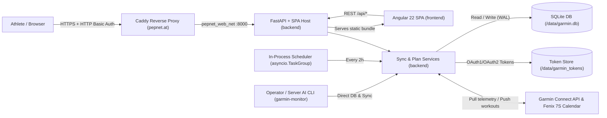

# Architecture

## Project Structure

- `backend/`: Python 3.14 FastAPI application, SQLite WAL storage layer, Garmin Connect synchronization service, training plan & Stammdaten engine, CLI (`garmin_monitor`), and `pytest` suite.
- `frontend/`: Angular 22.2 standalone single-page application (`OnPush`, Signals, Tailwind CSS v4, Apache ECharts) serving `/training` and `/health` views.
- `deploy/`: Production Caddy reverse-proxy configuration snippet (`Caddyfile.garmin.snippet`) for `pepnet.at`.
- `docs/`: Agent workflow templates (`docs/agents/`), architecture decision records (`docs/adr/`), server operational CLI playbook (`docs/operations-and-cli-playbook.md`), and implementation roadmap (`docs/roadmap-and-acceptance-criteria.md`).
- `.github/`: GitHub Actions CI/CD workflows (`ci.yml`, `cd.yml`), pull request and release templates, and issue templates (`ISSUE_TEMPLATE/`).
- `.agents/` and `.claude/`: Repository-scoped AI agent skills (`angular-developer`, `frontend-design`).
- `data/`, `.venv/`, `.ruff_cache/`, `.scratch/`: Local-only gitignored runtime data (`garmin.db`, `garmin_tokens/`), Python virtual environment, linter caches, and scratch workspace folders.

## High-Level System Diagram

## Core Components

- **Backend API & SPA Host (`backend`)**: FastAPI/Uvicorn service (`garmin_monitor.main:app` on port `8000`) serving REST endpoints (`/api/healthz`, `/api/status`, `/api/sync`, `/api/training/dashboard`, `/api/training/plan`, `/api/training/plan/days/{day_date}/notes`, `/api/training/plan/sync`, `/api/training/stammdaten`, `/api/health/overview`) and compiled Angular static assets with SPA fallback routing.
- **In-Process Sync Scheduler (`backend`)**: Background coordinator (`garmin_monitor.scheduler.SyncCoordinator` using `asyncio.TaskGroup` and `asyncio.timeout`) managed by the FastAPI lifespan that triggers periodic 2-hour Garmin Connect sync and plan reconciliation cycles.
- **Server CLI (`backend`)**: Command-line entrypoint (`python -m garmin_monitor` / `garmin-monitor`) for one-time Garmin SSO authentication (`auth login`), incremental/backfill synchronization (`sync`), training plan management (`plan summary|export|apply|sync`), and athlete master data management (`stammdaten summary|export|apply`).
- **Web UI (`frontend`)**: Angular 22.2 standalone SPA (`frontend/src/app`) rendering `/training` (`Dashboard`, `Plan`, and `Stammdaten` tabs) and `/health` (severity-ranked diagnostic banners, vitals KPI cards, and `7d / 30d / 90d` ECharts diagrams) over relative `/api/*` calls.

## Architectural invariants

- The production application runs as a single container (`garmin-monitor`, `mem_limit: 384m`) where FastAPI serves both `/api/*` JSON routes and the compiled Angular static bundle without a separate frontend web server container.
- Unknown `/api/*` routes always return strict HTTP 404 JSON responses and never fall through to the SPA `index.html` fallback handler.
- All persistent state resides in SQLite (`WAL` mode at `DATABASE_PATH`) and the Garmin OAuth token directory (`GARMIN_TOKEN_DIR`) on the host-mounted `/data` volume; no external database or message broker is introduced.
- Completed or partially completed historical training plan days (`date < today` in `Europe/Vienna` with status `done` or `partial`) and user-entered day `notes` are preserved untouched whenever `plan apply` updates a training plan.
- Authentication is enforced at the outer Caddy reverse proxy via HTTP Basic Auth (`deploy/Caddyfile.garmin.snippet`); the application layer remains stateless with respect to user sessions.
- All date boundaries, daily physiological series, and ISO-8601 training weeks (Monday `00:00:00` through Sunday `23:59:59`) are normalized to the configured IANA timezone (`Europe/Vienna`).
- Automated test suites maintain at least 80% coverage in both `backend` (`pytest-cov`) and `frontend` (`@vitest/coverage-v8`).

## Data Stores

- `SQLite Database (data/garmin.db)`: Owned by `backend` (`garmin_monitor.db`); stores `activities`, `daily_health`, `sync_runs`, `training_plans`, `plan_days`, and `stammdaten` tables in Write-Ahead Logging (`WAL`) mode with `busy_timeout = 5000`.
- `Garmin OAuth Token Store (data/garmin_tokens/)`: Owned by `backend` (`garmin_monitor.garmin_client`); persists `python-garminconnect` OAuth1/OAuth2 session tokens on disk for headless token refresh.

## External Integrations

- `Garmin Connect API`: Owned by `backend` (`garmin_monitor.garmin_client`, `sync_service`, and `plan_service`) via `python-garminconnect`; pulls activities and daily health telemetry and pushes/schedules structured workouts to the Garmin Fenix 7S Training Calendar.
- `GitHub Container Registry (ghcr.io)`: Owned by `.github/workflows/cd.yml` and `docker-compose.yml`; hosts pre-built multi-stage container images pulled by `pepnet.at` on release deployment.

---

## 1. Overview & Purpose

**Garmin Monitor** (`https://garmin.pepnet.at`) is a self-hosted training and physiological recovery monitoring platform for a Garmin Fenix 7S on `pepnet.at`.

### Core Capabilities
1. **Garmin Connect Sync & SQLite WAL Storage**: Periodically downloads activities and comprehensive daily physiological metrics into a local SQLite database (`WAL` mode), reconciles completed activities against an active training plan, and pushes structured/scheduled workouts to the Fenix 7S Training Calendar.
2. **Server-Side CLI & AI Operational Playbook ([`docs/operations-and-cli-playbook.md`](./docs/operations-and-cli-playbook.md))**: Enables an AI assistant running on `pepnet.at` to inspect training/health history and safely apply/reconcile training plan and athlete master data (`Stammdaten`) updates via CLI commands.
3. **FastAPI REST API (`/api/*`)**: Serves training dashboards, active training plans, inline day-note persistence (`PATCH /api/training/plan/days/{day_date}/notes`), athlete master data (`GET /api/training/stammdaten`), health telemetry, multi-signal health warnings, and sync controls.
4. **Angular Standalone SPA (`/training` & `/health`)**:
   - Shared global `7d / 30d / 90d` time-window selector across `/training` and `/health`.
   - `/training`: `Dashboard` tab (selected-window KPIs, completed workouts ledger with cadence/stride/power/TE/load, weekly ECharts diagrams), `Plan` tab (20-column structured sheet with goal-vs-actual telemetry, status badges, and inline auto-saving day notes), and `Stammdaten` tab (athlete profile, lactate/threshold diagnostics, HR zones, and hardware).
   - `/health`: Severity-ranked (`critical` / `warning`) diagnostic banners, current vitals KPI cards, and `7d / 30d / 90d` ECharts recovery trends.
5. **Quality Gates & GitHub Free CI/CD**:
   - Python 3.14 (`3.14.9`) with Ruff linting/formatting and `pytest` ≥ 80% coverage.
   - Node LTS (`26.13.0`) + Angular Standalone SPA with ESLint, Prettier, and headless unit tests ≥ 80% coverage.
   - GitHub Actions CI (`ci.yml`) and Release CD (`cd.yml`) deploying to `/opt/pepnet/garmin-monitor` on `pepnet.at` behind Caddy `basic_auth`.

### Explicit Non-Goals
- No web UI forms for authoring or editing training plan structure or workouts (structural mutations occur via CLI + AI on server; only per-day `notes` are editable inline in the `Plan` table).
- No web UI forms for editing custom health-warning threshold rules.
- No external push notifications (email, Telegram, ntfy, webhooks) — warnings appear in `/health` UI only.
- No granular per-set FIT SDK `exerciseCategory`/`exerciseName` rep-counting prompts on the watch for strength workouts.
- No raw `.fit` binary storage or per-second GPS/HR telemetry streams.
- No custom app-level login screens or session management (enforced globally at Caddy via HTTP Basic Auth).

---

## 2. Deployment & Infrastructure

- `Single Unified Container (garmin-monitor)`: Multi-stage `Dockerfile` (`node:26-alpine` build stage + `python:3.14-slim` runtime stage) running with `mem_limit: 384m` on port `8000` (`127.0.0.1:8000:8000`), serving `/api/*`, static SPA assets (`/app/static`), and the in-process background sync scheduler.
- `Production Host (/opt/pepnet/garmin-monitor on pepnet.at)`: Joined to external Docker network `pepnet_web_net` with `./data:/data` bind-mounted for `/data/garmin.db` and `/data/garmin_tokens/`.
- `Reverse Proxy & Authentication`: HTTP Basic Auth enforced at `/opt/pepnet/caddy/Caddyfile` (`basic_auth` + `reverse_proxy garmin-monitor:8000`); Angular uses relative `/api/*` paths so the browser automatically attaches the cached `Authorization` header.
- `Timezone & Week Convention`: Default timezone `Europe/Vienna`; weekly training aggregations use ISO-8601 weeks (Monday `00:00:00` through Sunday `23:59:59`).

## Security Considerations

- `Caddy Basic Auth Trust Boundary`: External HTTPS requests to `https://garmin.pepnet.at` are authenticated by Caddy before reaching `garmin-monitor:8000` over `pepnet_web_net`; host port `8000` binds strictly to `127.0.0.1`.
- `Credential & Token Isolation`: `GARMIN_EMAIL`, `GARMIN_PASSWORD`, and persisted OAuth tokens in `GARMIN_TOKEN_DIR` (`0700` on host) remain on the gitignored `/data` volume and are never returned by `/api/*` responses.
- `Restricted AI SSH Boundary (ssh pepnet-llm)`: AI agents connect via an unprivileged SSH alias (`pepnet-llm`) outside `sudo` and `docker` groups, restricted via scoped `sudoers` to container diagnostics and the `garmin_monitor` CLI, with read-only `?immutable=1` SQLite access to `garmin.db` and no access to `GARMIN_TOKEN_DIR`.
- `Non-Root Execution & Static Path Confinement`: The runtime container runs as unprivileged user `garmin` (`UID 10001`), and `serve_spa` verifies `candidate.is_relative_to(static_dir.resolve())` before serving static files.

---

## 3. Data Scope & Synchronization Cadence

- **Authentication Bootstrap**: Uses `python-garminconnect` (`>=0.3.0`, `curl_cffi`-based) persisting session tokens in `GARMIN_TOKEN_DIR`. Interactive login (`python -m garmin_monitor auth login`) seeds tokens once; headless runs reload tokens without triggering MFA or `429` lockouts.
- **Initial Backfill**: 90 days of activities and daily health records when the database is empty (or via CLI `--days`).
- **Periodic Sync**: Every 2 hours in-process, re-fetching today and yesterday (`Europe/Vienna`), plus on-demand `POST /api/sync` and CLI `sync`.
- **Stored Activity Metrics (`activities` table)**:
  - `activity_id` (PK), `activity_name`, `sport_type`, `start_time_local`, `date_local`, `duration_sec`, `distance_m`, `avg_hr`, `max_hr`, `avg_speed_mps`, `calories`, `elevation_gain_m`, `aerobic_te`, `anaerobic_te`, `training_load`, `associated_workout_id`, `raw_json`, `synced_at`.
- **Stored Daily Health Metrics (`daily_health` table)**:
  - `date` (PK, `YYYY-MM-DD`), Sleep (`sleep_score`, `sleep_qualifier`, `sleep_total_sec`, `sleep_deep_sec`, `sleep_light_sec`, `sleep_rem_sec`, `sleep_awake_sec`), HRV (`hrv_nightly_avg`, `hrv_weekly_avg`, `hrv_baseline_low`, `hrv_baseline_high`, `hrv_status`), Heart Rate (`resting_hr`, `min_hr`, `max_hr`), Stress (`stress_avg`, `stress_max`), Body Battery (`body_battery_high`, `body_battery_low`), SpO2 (`spo2_avg`, `spo2_low`), Respiration (`respiration_avg`), Steps (`steps`), Training Readiness (`training_readiness_score`, `training_readiness_level`), `raw_json`, `synced_at`.
- **Sync Execution Logs (`sync_runs` table)**:
  - `id` (PK), `started_at`, `finished_at`, `status` (`running` | `success` | `error`), `days_requested`, `activities_synced`, `health_days_synced`, `error_message`.

---

## 4. Training Plan, Stammdaten Engine & Auto-Completion Rules

### Storage & CLI (`training_plans`, `plan_days`, and `stammdaten` tables)
- CLI commands:
  - `python -m garmin_monitor plan summary`
  - `python -m garmin_monitor plan export [-o <file>]`
  - `python -m garmin_monitor plan apply <file.yaml|json> [--no-garmin-sync]`
  - `python -m garmin_monitor plan sync [--force]`
  - `python -m garmin_monitor stammdaten summary`
  - `python -m garmin_monitor stammdaten export [-o <file>]`
  - `python -m garmin_monitor stammdaten apply <file.yaml|json>`
- Stored Plan Day Metrics (`plan_days` table):
  - Planned targets: `date` (unique), `sport_type`, `workout_title`, `focus`, `goal_km`, `goal_duration_min`, `hr_goal_label`, `hr_min`, `hr_max`, `steps_json`, `garmin_workout_id`, `garmin_schedule_id`.
  - Reconciled actuals & notes: `actual_km`, `actual_duration_min`, `actual_avg_hr`, `actual_max_hr`, `actual_pace_min_per_km`, `actual_cadence_spm`, `actual_stride_m`, `actual_power_w`, `actual_training_load`, `actual_aerobic_te`, `actual_anaerobic_te`, `actual_calories`, `rpe`, `notes`, `matched_activity_ids`, `status`.
- Stored Athlete Master Data (`stammdaten` table):
  - `id` (PK), `sort_order`, `category`, `parameter`, `value`, `unit_or_range`, `reference_note`, `updated_at`.
- Inline Day Notes Endpoint:
  - `PATCH /api/training/plan/days/{day_date}/notes` persists user-entered training notes/feelings on blur in SQLite and updates the stored plan YAML snapshot.
- On `plan apply`:
  - Preserves completed historical rows (`date < today` with `done` or `partial`) and existing user notes.
  - Updates `stammdaten` if included in the plan YAML.
  - Reconciles future Garmin Connect workouts by deleting/unscheduling superseded `garmin_workout_id` / `garmin_schedule_id` items before uploading and calendar-scheduling updated future days (`date >= today`).
  - **Running workouts** (`sportTypeId: 1`, `sportTypeKey: "running"`): Full structured steps (warmup, intervals/repeats, cooldown with distance/time durations and HR/pace targets) scheduled on `date`.
  - **Strength workouts** (`sportTypeId: 5`, `sportTypeKey: "strength_training"`): Calendar-scheduled strength workout with planned duration and focus/intensity description (open/timed step).

### Auto-Completion Rules (`reconcile_plan_completions`)
1. Match `plan_days` against synced `activities`:
   - Priority 1: `activity.associated_workout_id == plan_day.garmin_workout_id` (when non-null).
   - Priority 2 (fallback): `activity.date_local == plan_day.date` and matching `sport_type` (aggregating total distance, total duration, duration-weighted avg HR, and max HR across same-day sessions of that sport).
2. Status evaluation (using Python 3.14 `match / case`):
   - `rest`: Marked `rest` (completed rest day once date passes or on schedule).
   - `done`: Matched activity has actual `km` (running) or `actual_duration_min` (strength) **≥ 80%** of planned target (or if no numeric target was set and a matching session occurred).
   - `partial`: Matched activity exists but is **< 80%** of target.
   - `missed`: `date < today` (`Europe/Vienna`) on a workout day with no matched activity.
   - `pending`: `date >= today` (`Europe/Vienna`) with no matched activity yet.

---

## 5. Health Problem Warnings Rules (`warnings.py`)

Evaluated across the daily health series and sync status, returning severity-ranked (`critical` first, then `warning`) diagnostics:
1. **Garmin Native HRV Status**:
   - `hrv_status` in `{"POOR", "LOW"}` -> `critical`
   - `hrv_status == "UNBALANCED"` -> `warning`
2. **HRV Personal Baseline Breach**:
   - `hrv_nightly_avg < hrv_baseline_low` (or below 30-day rolling personal baseline `[mean - 1.5*sd]` when Garmin bounds are absent) -> `warning` (`critical` if ≥ 15% below low bound).
3. **Sleep Quality & Consecutive Poor Sleep**:
   - `sleep_qualifier == "POOR"` on latest day -> `warning`
   - `sleep_score < 60` for **≥ 2 consecutive days** ending on the latest recorded day -> `critical` (single day `< 60` -> `warning`).
4. **Elevated Resting Heart Rate**:
   - Latest `resting_hr >= 30_day_rolling_mean + 5` bpm -> `warning` (`>= +8` bpm -> `critical`).
5. **Low Morning Body Battery**:
   - Latest `body_battery_high < 50` -> `warning` (`< 35` -> `critical`).
6. **Sync Health / Staleness**:
   - Last sync failed (`status == "error"`) or last successful sync is **> 6 hours old** (or never synced) -> `critical`.

---

## 6. Toolchain & Code Standards

- **Python**: `3.14.9` in `.python-version`, `requires-python = ">=3.14"` in `backend/pyproject.toml`.
  - PEP 695 `type` aliases (`type PlanDayStatus = ...`), PEP 701 f-strings, PEP 604 unions (`T | None`), `typing.override`, `typing.Self`, `asyncio.TaskGroup`, `asyncio.timeout`, Pydantic v2 strict models.
  - Ruff `target-version = "py314"`, rules `["E", "F", "W", "I", "UP", "B", "RUF", "ASYNC"]`.
  - Pytest coverage ≥ 80% (`--cov=garmin_monitor --cov-fail-under=80`).
- **Node & Angular**: Node `26.13.0` & npm `11.20.0` in `frontend/package.json` (`engines`) and `frontend/.node-version`.
  - Standalone components, Signals (`signal`, `computed`, `input`, `output`), control flow (`@if`, `@for`, `@switch`), Tailwind CSS, Apache ECharts (`ngx-echarts`).
  - ESLint (`ng lint`), Prettier (`prettier --check`), and headless unit tests with ≥ 80% coverage across statements, branches, functions, and lines.

---

## Future Considerations / Roadmap

- Structural mutations to training plans and warning thresholds remain intentionally CLI-driven (`plan apply`, `stammdaten apply`) rather than exposed through web forms; see [`docs/roadmap-and-acceptance-criteria.md`](./docs/roadmap-and-acceptance-criteria.md) for the full implementation history and acceptance criteria.
- Strength workouts scheduled to the Fenix 7S intentionally use timed/open workout steps rather than granular per-set FIT SDK `exerciseCategory`/`exerciseName` rep-counting prompts.

## Domain language

**Stammdaten** (Athlete Master Data): Persistent athlete physiological reference parameters, lactate threshold diagnostics (`LT1`, `LT2`, `HFmax`), heart-rate training zones (`GA1`, `GA2`), and hardware notes stored in the `stammdaten` table and rendered in the `/training` Stammdaten tab. _Avoid_: user profile, account settings, athlete preferences.

**Plan Day** (`plan_days`): A single calendar-date entry in the active training plan combining planned workout targets (`sport_type`, `workout_title`, `focus`, `goal_km`, `goal_duration_min`, `hr_min`, `hr_max`, `steps_json`), Garmin watch identifiers (`garmin_workout_id`, `garmin_schedule_id`), reconciled actual telemetry (`actual_*`), completion `status`, and inline `notes`. _Avoid_: calendar event, workout template, todo item.

**Plan Reconciliation** (`reconcile_plan_completions`): The deterministic post-sync evaluation that matches synced Garmin `activities` to `plan_days` (first by `associated_workout_id == garmin_workout_id`, then by `date_local` and `sport_type`) and assigns `done` (≥ 80% target), `partial` (< 80% target), `missed`, `pending`, or `rest`. _Avoid_: activity grading, workout scoring, manual completion.

**Health Warning** (`HealthWarning`): A severity-ranked (`critical` or `warning`) physiological or sync-staleness diagnostic computed by `warnings.py` from recent `daily_health` series (HRV status, personal HRV baseline breach, consecutive poor sleep, elevated resting HR, low morning Body Battery) and `sync_runs`. _Avoid_: alert notification, medical alarm, push alert.

**Sync Run** (`sync_runs`): A recorded execution audit row for a scheduled, CLI, or manual (`POST /api/sync`) Garmin Connect synchronization cycle tracking timestamps, requested day window, synced activity/health counts, and `running` / `success` / `error` status. _Avoid_: cron job log, import batch, webhook delivery.
